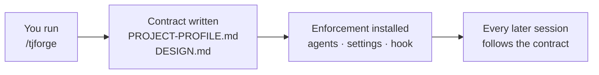
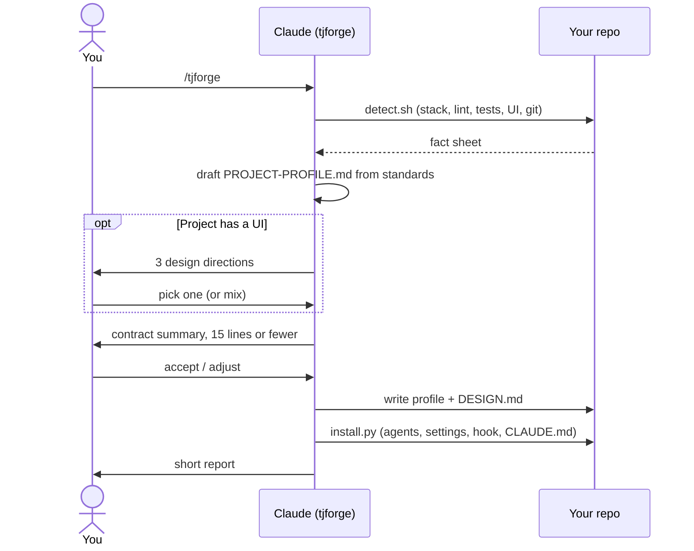
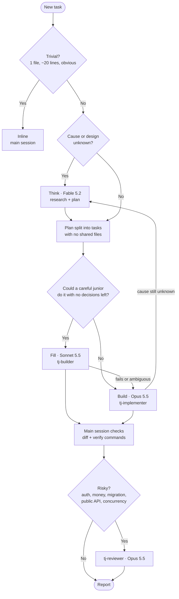
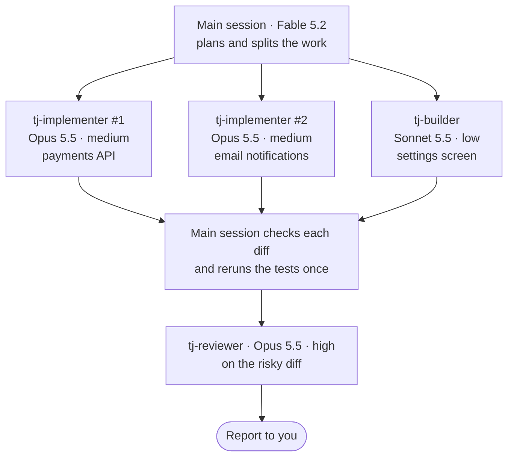
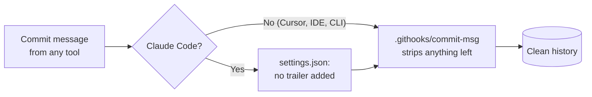

# tjforge

**Website:** https://tjthouhid.github.io/tjforge/

A Claude Code skill that sets up an engineering contract for any project, then makes every later session follow it.

Run `/tjforge` in a repository and it:

- detects the stack, tooling, tests and existing design system
- drafts the project's system design, coding standards, verify commands and git rules
- proposes a design direction for UI projects and records the one you pick
- installs subagents that route work to the right model, so you get good results without burning tokens
- blocks AI attribution (`Co-Authored-By`, "Generated with …") from commits and pull requests



## Best for

| Good fit | Why tjforge helps |
|---|---|
| Starting a new project with Claude | Stack, architecture, standards and design are decided before the first file, not drifted into |
| Taking over an existing codebase | Detection writes down conventions the repo already follows, so Claude stops "improving" them |
| Landing pages, portfolios, brand sites | The design brief forces a specific direction with no centered hero, default fonts or stock copy |
| Product apps and dashboards | A restrained stance: tokens, consistent states, motion only as feedback |
| Long or multi-session work | `CLAUDE.md` and the profile carry the decisions, so you do not re-explain them each session |
| Large features | Fable plans, Opus builds, Sonnet fills in, and risky diffs get an independent review |
| Repos where commits must look human-authored | Attribution is off at the source and stripped by a hook |

| Not worth it | Use instead |
|---|---|
| A one-off script or a single quick fix | Just ask Claude directly |
| Throwaway prototypes you will delete tomorrow | Plain Claude Code |
| Repos where you cannot commit `.claude/` or `CLAUDE.md` | Keep the rules in your personal `~/.claude/CLAUDE.md` |
| Teams that pair and need human `Co-authored-by` lines | Edit the hook first (see [No AI attribution](#no-ai-attribution)) |

## Install

```bash
git clone https://github.com/tjthouhid/tjforge.git ~/.claude/skills/tjforge
```

Start a new Claude Code session and `/tjforge` is available in every project.

Update:

```bash
git -C ~/.claude/skills/tjforge pull
```

Requires Claude Code, `git`, `bash` and `python3` (macOS and Linux ship them).

## Quick start

1. Open the project in Claude Code. Pick **Fable 5.2** as the model; use effort high for big planning sessions, medium for everyday work.
2. Run `/tjforge init`. Accept or adjust the summary, and pick a design direction if the project has a UI.
3. If the project had no `.claude/agents` folder before, start a new session so the agents load.
4. Work normally: "add a booking page", "fix the checkout bug", or `/tjforge <task>`. Fable plans and hands work to Opus and Sonnet agents itself.

You only run `init` once per project. After that the `CLAUDE.md` block makes every session follow the contract.

## Usage

| Command | What it does |
|---|---|
| `/tjforge` or `/tjforge init` | Detect, draft the contract, confirm with you once, install enforcement |
| `/tjforge design` | Redo the design brief only |
| `/tjforge check` | Report what is installed, missing, outdated or edited |
| `/tjforge sync` | Bring the project's agents, hook, settings and CLAUDE.md block up to date |
| `/tjforge <task>` | Do a task under the contract, with model routing |

Init is also triggered automatically when you ask Claude to set up a project that has no `docs/PROJECT-PROFILE.md`.

### Auto-sync

Every `/tjforge` run (except `check`) first syncs the project with the current skill. Change tjforge once, and each project picks up the new agents, hook and rules the next time you call `/tjforge` there.

- Your `docs/PROJECT-PROFILE.md` and `DESIGN.md` are never touched.
- Files tjforge manages are recorded with a hash in `.claude/tjforge.lock.json`. A file you edited in a project is left alone, with a warning saying so. Re-run with `--force` only if you want the template back.
- When nothing changed it prints nothing, so it costs almost no tokens.

Plain sessions that do not call `/tjforge` still follow the contract, but they do not sync. Run `/tjforge sync` after updating tjforge if you want a project refreshed without starting a task.

### Which command when


Once init has run, plain requests ("add a pricing page", "fix the login bug") follow the contract too, because the `CLAUDE.md` block points every session at it.

### How init runs



### What init asks

Almost nothing in an existing project. Detection fills most of the profile, and you get one summary to accept or adjust. In an empty folder it asks at most three questions: what you are building, which stack (or "recommend one"), and whether it has a UI.

For UI projects it proposes three distinct design directions, five lines each:

1. Name and mood, with a concrete reference
2. Palette, 4 to 6 hex values with roles
3. Display and text typefaces, and why they fit
4. Layout idea and the one layout-breaking moment
5. Motion signature, the interaction nobody expects from a template

You pick one, or mix them. If the project already has a design system, tjforge documents it instead of inventing a new one.

Example of one direction, for a Basque open-fire grill restaurant site:

> **A. Ember Cinema** *(recommended)*
> 1. Mood: dark, smoky, like the opening shot of a food documentary
> 2. Palette: `#0B0907` charcoal bg · `#1A1410` smoke surface · `#F2E6D8` ash text · `#E8541E` ember accent
> 3. Type: Fraunces italic for display (warm, high contrast at large sizes) · Space Mono for prices and captions
> 4. Layout: letterbox hero, asymmetric editorial menu; the break is a horizontal-scroll dish strip
> 5. Motion: the colour grade warms from blue-grey to amber as you scroll

How surfaces are treated:

| Surface | Stance | Motion |
|---|---|---|
| Marketing, landing, portfolio | Expressive: art direction, editorial grid, custom cursor | A signature interaction |
| Product app, dashboard | Restrained: density, clarity, consistent components | Feedback only |
| Docs, blog | Typographic: reading comfort first | Minimal |
| Mobile | Platform conventions first, brand second | Native |

## What it writes into your project

```
your-project/
├── CLAUDE.md                     tjforge block added between markers (your content is kept)
├── DESIGN.md                     design brief (UI projects only)
├── docs/PROJECT-PROFILE.md       the engineering contract
├── .claude/
│   ├── tjforge.lock.json         hashes of managed files, so your edits are never overwritten
│   ├── settings.json             attribution off (existing keys are merged, not replaced)
│   └── agents/
│       ├── tj-architect.md       Fable 5.2 · high, read-only research and planning
│       ├── tj-implementer.md     Opus 5.5 · medium, implementation
│       ├── tj-reviewer.md        Opus 5.5 · high, read-only independent review
│       └── tj-builder.md         Sonnet 5.5 · low, mechanical work
└── .githooks/commit-msg          strips AI-attribution trailers
```

Commit these files so the contract and the hook travel with the repository. Each new clone activates the hook once with:

```bash
git config core.hooksPath .githooks
```

Or re-run the installer in the clone, which does it for you:

```bash
python3 ~/.claude/skills/tjforge/scripts/install.py
```

## Model routing

| Tier | Model | Agent | Effort | Use for |
|---|---|---|---|---|
| Think | Fable 5.2 | main session, `tj-architect` | your session setting · `high` | research, architecture, plans for big tasks, unknown-cause bugs, trade-offs |
| Build | Opus 5.5 | `tj-implementer`, `tj-reviewer` | `medium` · `high` | multi-file features, real logic, known-cause fixes, refactors, migrations, security-sensitive code, review |
| Fill | Sonnet 5.5 | `tj-builder`, `Explore` | `low` · default | fully specified boilerplate, CRUD or screens from an existing pattern, test-only changes, docs, copy edits, renames, config, codebase search |
| Inline | current | main session | session | one file, about 20 lines, obvious change |

How a task is routed:



Examples:

| Request | Route |
|---|---|
| "Fix the typo in the footer" | Inline |
| "Add a `/health` endpoint like the existing `/status`" | Fill (Sonnet) |
| "Add Stripe checkout with webhooks" | Think plans → Build implements → Reviewer checks |
| "Checkout fails for some users, no idea why" | Think investigates → Build fixes |
| "Rename `userId` to `accountId` across the app" | Fill, split by folder, in parallel |
| "Should we split search into its own service?" | Think only |

Rules:

- A task is big when it touches more than 3 files, adds a module or data model, changes a public interface, or has an unknown cause. Big tasks get a plan before code.
- Open questions never go to Sonnet. If a Sonnet task fails once or hits ambiguity, it moves up to Opus instead of retrying.
- Parallel agents never share a file.
- An agent's report is a claim. The main session reruns the verify commands once and reads the risky parts of the diff before saying done.
- Risky changes (auth, money, migrations, public API, concurrency) get an independent `tj-reviewer` pass.

Why these effort levels: planning and review are where deeper reasoning catches mistakes, and they run rarely, so they get `high`. The implementer works from a finished plan, so `medium` gets the same result for fewer tokens. The builder's work is fully specified, so `low` is enough.

Precedence, highest first: the `CLAUDE_CODE_EFFORT_LEVEL` environment variable, then an effort passed for one delegation, then the agent's `effort:` field, then your session level. Your session level (`/effort`) only applies to agents on the same model as the main session, so tjforge pins each agent's level instead.

The full rules are in [references/routing.md](references/routing.md).

### Parallel agents

An agent file is a template, not a single worker. The main session can start several copies at once, one per task, and each copy runs on the model and effort pinned in its file. Two `tj-implementer` copies are both Opus 5.5 at medium, whatever the main session runs.



| Situation | What happens |
|---|---|
| Independent tasks on different files | Separate copies, in parallel |
| Small related tasks | One copy does them all, with one verification run (shared context loads once) |
| Task B needs task A's result, or both edit the same file | One after another |

- Each copy starts fresh. It knows only its brief and the project files.
- Agents do not talk to each other. Each reports to the main session, which combines and checks the results.
- Parallel agents share the working folder, so they are never given the same file. For full isolation, add `isolation: worktree` to an agent file. Each copy then works in its own git worktree, and you merge the branches afterwards.

### Budget

Rules that keep token use down on every task:

| Rule | Detail |
|---|---|
| Tests run once | The agent runs each suite once and the lead reruns it once. Three runs in a row only for money, auth or access-control changes, a suspected flaky test, or a release exit |
| Cheapest proof first | Unit, then integration, then end to end. Full end-to-end only when the change is visible in a browser or touches a shared path |
| Short briefs | At most 40 lines: goal, files, done-when, three review points. Docs by path, never pasted history |
| Short reports | Implementer 200 words, builder 120, reviewer 300, unless a failure needs explaining |
| Batch small work | Small related tasks go to one agent with one verification run |
| Review by risk | The lead reads migrations, auth, money and the brief's review points closely, and skims the rest |
| Ceiling | Past about 300k agent tokens or one hour, Claude stops and tells you why before continuing |

Schema, money, security and concurrency always go to Opus. New UI on an expressive surface also stays on Opus, because the design brief is the first thing a cheaper model drops. Screens that copy an existing pattern can go to Sonnet.

## No AI attribution



Before and after the hook:

```diff
  feat: add checkout page

  Adds Stripe checkout with webhook handling.
-
- 🤖 Generated with [Claude Code](https://claude.com/claude-code)
-
- Co-Authored-By: Claude <noreply@anthropic.com>
```

Two layers, so it holds regardless of which tool writes the commit:

1. **At the source.** `.claude/settings.json` gets `"attribution": {"commit": "", "pr": ""}`, so Claude Code never adds the trailer or the PR footer.
2. **Backstop.** `.githooks/commit-msg` removes these lines from any commit message before it is written:
   - `Co-authored-by:` (any casing)
   - `Generated with [Claude Code]`, `Generated with Cursor`, `Generated by Cursor`
   - `Made-with: Cursor`

The hook removes **every** `Co-authored-by` line, including human co-authors. Edit [templates/githooks/commit-msg](templates/githooks/commit-msg) if you pair with people and want to keep theirs.

If the repository already uses husky, lefthook or another hooks folder inside the project, the installer adds one line to that folder's `commit-msg` instead of taking over `core.hooksPath`. If the hooks folder is outside the project, it prints the line for you to add.

## Standards it applies

The order of authority is: what the repo already does, then what you said, then tjforge's defaults. It never restyles an existing codebase to match a default.

- **System design.** A modular monolith by default for a new product. Boundaries and dependency direction are recorded, along with failure handling, config and observability, and the trigger that would justify changing the design. See [references/standards.md](references/standards.md).
- **Coding.** The strictest type mode the language has, the repo's formatter and linter at zero warnings, errors never swallowed, comments that say why, and new dependencies only with a stated reason.
- **Testing.** Exact verify commands recorded. Tests are required for business rules, bug fixes, money maths and authorization. "Done" means the commands ran and passed.
- **Design.** No centered hero with three cards, no default fonts, no stock copy. Token-first. Responsive at 375, 768, 1440 and 1920. Animates only transform and opacity, has a reduced-motion fallback, and meets WCAG AA. See [references/design-brief.md](references/design-brief.md).

tjforge also points Claude at other installed skills for depth (`clean-architecture`, `system-design`, `top-design`, `refactoring-ui`, `web-typography` and others) and skips any that are missing.

## Repository layout

```
SKILL.md                    entry point Claude Code loads
references/
  routing.md                model tiers, escalation, brief template
  standards.md              how to fill the profile
  design-brief.md           design directions and anti-generic rules
scripts/
  detect.sh                 read-only project fact sheet
  install.py                idempotent installer; --check to audit
templates/
  PROJECT-PROFILE.md
  DESIGN.md
  claude-md-block.md
  agents/                   the four tj-* subagents
  githooks/commit-msg
```

## Customising

- **Models and effort.** The agents pin exact model IDs (`claude-fable-5-2`, `claude-opus-5-5`, `claude-sonnet-5-5`) and an `effort:` level (`low`, `medium`, `high`, `xhigh` or `max`; available levels depend on the model) in `templates/agents/*.md`. Change those lines; each project picks them up on its next `/tjforge` run, or straight away with `/tjforge sync`.
- **Rules.** Edit the files in `references/`. They are plain Markdown and are read fresh on every run.
- **Per project.** Edit `docs/PROJECT-PROFILE.md` or `DESIGN.md` directly. Claude treats them as the contract, and they override tjforge's defaults.

## What to expect

tjforge is designed to use fewer tokens, finish faster and produce more consistent work. Those gains have not been benchmarked. To measure them, run the same task on two copies of a project, with and without tjforge, and compare tokens, time and the result.

| | Expected effect | Why |
|---|---|---|
| Tokens | Lower | Trivial edits inline, mechanical work on Sonnet at low effort, tests run once, capped briefs and reports |
| Speed | Usually faster | Low-effort agents, parallel copies, fewer reruns. Slower for the one-time `init`, and for tiny tasks if they were delegated (they are not) |
| Quality | More consistent | Same contract and design brief every session, tests rerun by the lead, independent review of risky changes |

It does not make the work perfect:

- Claude follows the written rules most of the time, not always. Only the commit hook and the attribution setting are enforced mechanically.
- A task misrouted to Sonnet costs one retry on Opus.
- Short reports can hide detail. That is why the lead reruns the tests itself.
- Review the result yourself, especially design taste, business logic and anything going to production.

## Notes

- Claude Code picks up agent files without a restart, except in a project that had no `.claude/agents` folder before. There they load on the next session, and until then tjforge falls back to general-purpose agents with an explicit model.
- `install.py` is safe to re-run. It only writes what is missing or out of date, and `--check` exits 1 when anything is missing or outdated.
- To refresh every project at once after updating tjforge, without opening each one:

  ```bash
  find ~ -path '*/.claude/tjforge.lock.json' -not -path '*/Library/*' 2>/dev/null | while read -r f; do (cd "$(dirname "$(dirname "$f")")" && python3 ~/.claude/skills/tjforge/scripts/install.py --quiet); done
  ```
- Nothing is committed during init unless you ask.

## License

[MIT](LICENSE)
