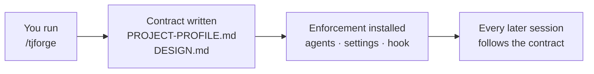
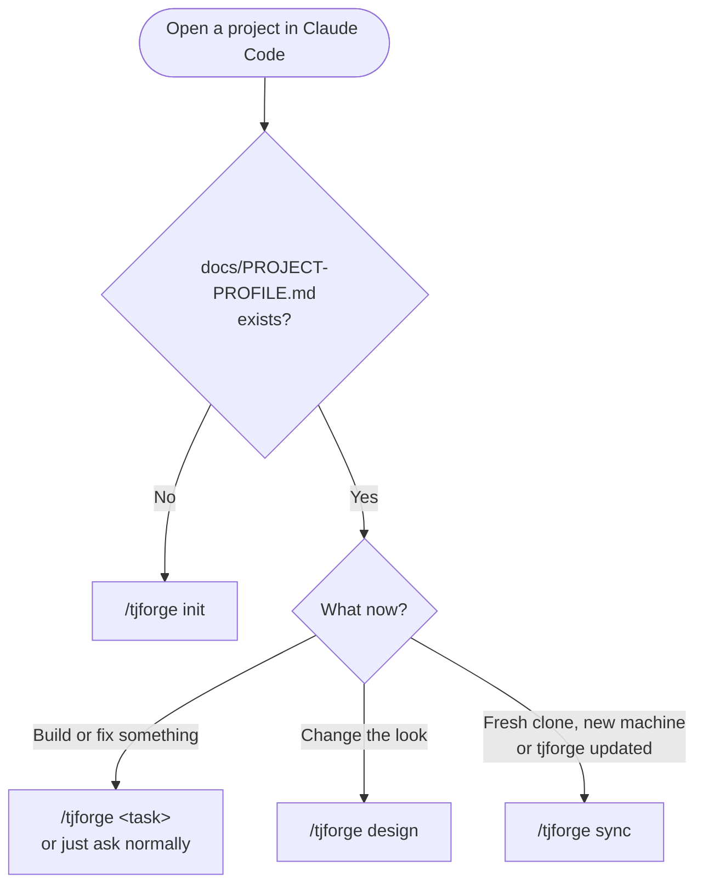
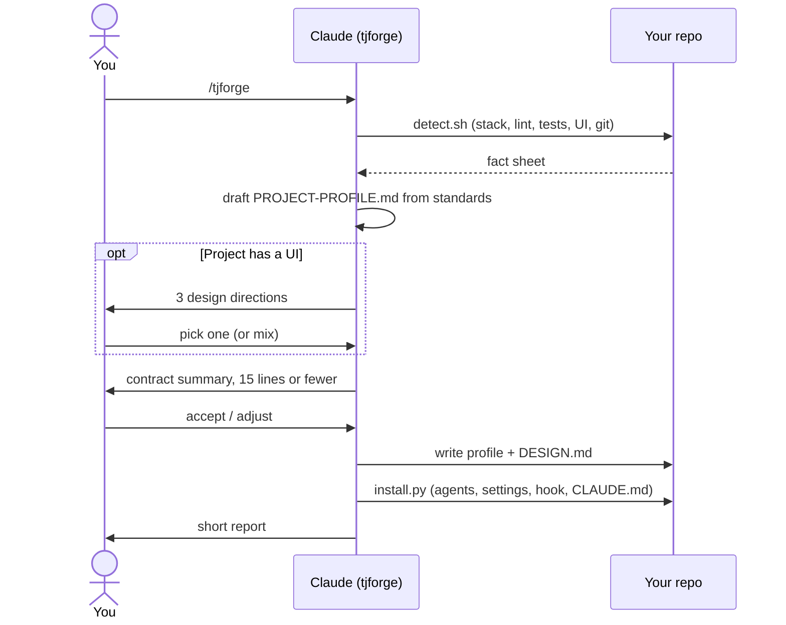
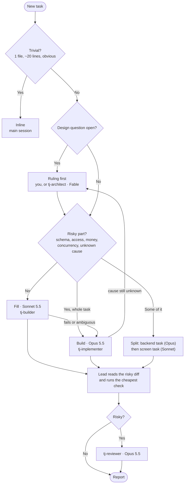
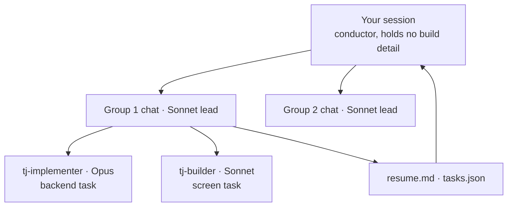
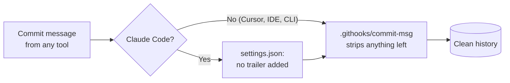

# tjforge

**Website:** https://tjthouhid.github.io/tjforge/

A Claude Code skill that sets up an engineering contract for any project, then makes every later session follow it.

Run `/tjforge` in a repository and it:

- detects the stack, tooling, tests and existing design system
- drafts the project's system design, coding standards, verify commands and git rules
- proposes a design direction for UI projects and records the one you pick
- installs subagents that route work to the right model, so you get good results without burning tokens
- blocks AI attribution (`Co-Authored-By`, "Generated with …") from commits and pull requests



## Best for

| Good fit | Why tjforge helps |
|---|---|
| Starting a new project with Claude | Stack, architecture, standards and design are decided before the first file, not drifted into |
| Taking over an existing codebase | Detection writes down conventions the repo already follows, so Claude stops "improving" them |
| Landing pages, portfolios, brand sites | The design brief forces a specific direction with no centered hero, default fonts or stock copy |
| Product apps and dashboards | A restrained stance: tokens, consistent states, motion only as feedback |
| Long or multi-session work | `CLAUDE.md` and the profile carry the decisions, so you do not re-explain them each session |
| Large features | Sonnet leads and fills in, Opus builds only the risky parts, Fable advises on call, and risky diffs get an independent review |
| Repos where commits must look human-authored | Attribution is off at the source and stripped by a hook |

| Not worth it | Use instead |
|---|---|
| A one-off script or a single quick fix | Just ask Claude directly |
| Throwaway prototypes you will delete tomorrow | Plain Claude Code |
| Repos where you cannot commit `.claude/` or `CLAUDE.md` | Keep the rules in your personal `~/.claude/CLAUDE.md` |
| Teams that pair and need human `Co-authored-by` lines | Edit the hook first (see [No AI attribution](#no-ai-attribution)) |

## Install

```bash
git clone https://github.com/tjthouhid/tjforge.git ~/.claude/skills/tjforge
```

Start a new Claude Code session and `/tjforge` is available in every project.

Update:

```bash
git -C ~/.claude/skills/tjforge pull
```

`/tjforge` checks for a newer version at most once a day and prints one line when there is one. It never updates by itself. To hear about releases on GitHub, choose **Watch → Custom → Releases** on the repository. What changed, and how to upgrade a project, is in [CHANGELOG.md](CHANGELOG.md).

Requires Claude Code, `git`, `bash` and `python3` (macOS and Linux ship them).

## Quick start

1. Open the project in Claude Code. Pick **Sonnet 5.5** as the model (Opus 5.5 for a build that is mostly schema, money or access rules); effort medium.
2. Run `/tjforge init`. Accept or adjust the summary, and pick a design direction if the project has a UI.
3. If the project had no `.claude/agents` folder before, start a new session so the agents load.
4. Work normally: "add a booking page", "fix the checkout bug", or `/tjforge <task>`. The session plans and hands work to Sonnet and Opus agents itself, and asks Fable only for rulings.

You only run `init` once per project. After that the `CLAUDE.md` block makes every session follow the contract.

## Usage

| Command | What it does |
|---|---|
| `/tjforge` or `/tjforge init` | Detect, draft the contract, confirm with you once, install enforcement |
| `/tjforge design` | Redo the design brief only |
| `/tjforge check` | Report what is installed, missing, outdated or edited |
| `/tjforge sync` | Bring the project's agents, hook, settings and CLAUDE.md block up to date |
| `/tjforge <task>` | Do a task under the contract, with model routing |

Init is also triggered automatically when you ask Claude to set up a project that has no `docs/PROJECT-PROFILE.md`.

In a terminal, from the project folder:

| Command | What it does |
|---|---|
| `python3 ~/.claude/skills/tjforge/scripts/install.py` | Same as `/tjforge sync`, without opening Claude Code |
| `… install.py --check` | Report only; exits 1 if anything is missing, outdated or edited |
| `… install.py --quiet` | Print nothing when everything is already in sync |
| `… install.py --force` | Replace managed files even if you edited them in the project |
| `git -C ~/.claude/skills/tjforge pull` | Update the skill itself |
| `git config core.hooksPath .githooks` | Turn on the commit hook in a fresh clone (the installer also does this) |

### Auto-sync

Every `/tjforge` run (except `check`) first syncs the project with the current skill. Change tjforge once, and each project picks up the new agents, hook and rules the next time you call `/tjforge` there.

- Your `docs/PROJECT-PROFILE.md` and `DESIGN.md` are never touched.
- Files tjforge manages are recorded with a hash in `.claude/tjforge.lock.json`. A file you edited in a project is left alone, with a warning saying so. Re-run with `--force` only if you want the template back.
- When nothing changed it prints nothing, so it costs almost no tokens.

Plain sessions that do not call `/tjforge` still follow the contract, but they do not sync. Run `/tjforge sync` after updating tjforge if you want a project refreshed without starting a task.

### Which command when



Once init has run, plain requests ("add a pricing page", "fix the login bug") follow the contract too, because the `CLAUDE.md` block points every session at it.

### How init runs



### What init asks

Almost nothing in an existing project. Detection fills most of the profile, and you get one summary to accept or adjust. In an empty folder it asks at most three questions: what you are building, which stack (or "recommend one"), and whether it has a UI.

For UI projects it proposes three distinct design directions, five lines each:

1. Name and mood, with a concrete reference
2. Palette, 4 to 6 hex values with roles
3. Display and text typefaces, and why they fit
4. Layout idea and the one layout-breaking moment
5. Motion signature, the interaction nobody expects from a template

You pick one, or mix them. If the project already has a design system, tjforge documents it instead of inventing a new one.

Example of one direction, for a Basque open-fire grill restaurant site:

> **A. Ember Cinema** *(recommended)*
> 1. Mood: dark, smoky, like the opening shot of a food documentary
> 2. Palette: `#0B0907` charcoal bg · `#1A1410` smoke surface · `#F2E6D8` ash text · `#E8541E` ember accent
> 3. Type: Fraunces italic for display (warm, high contrast at large sizes) · Space Mono for prices and captions
> 4. Layout: letterbox hero, asymmetric editorial menu; the break is a horizontal-scroll dish strip
> 5. Motion: the colour grade warms from blue-grey to amber as you scroll

How surfaces are treated:

| Surface | Stance | Motion |
|---|---|---|
| Marketing, landing, portfolio | Expressive: art direction, editorial grid, custom cursor | A signature interaction |
| Product app, dashboard | Restrained: density, clarity, consistent components | Feedback only |
| Docs, blog | Typographic: reading comfort first | Minimal |
| Mobile | Platform conventions first, brand second | Native |

## What it writes into your project

```
your-project/
├── CLAUDE.md                     tjforge block added between markers (your content is kept)
├── DESIGN.md                     design brief (UI projects only)
├── docs/PROJECT-PROFILE.md       the engineering contract
├── docs/worker-brief.md          standing rules workers read (60 lines or fewer)
├── docs/decisions-log.md         one line per decision; workers do not read it
├── docs/builds/<name>/           plan, tasks.json, resume and notes of a multi-task build
├── .claude/
│   ├── tjforge.lock.json         hashes of managed files, so your edits are never overwritten
│   ├── settings.json             attribution off (existing keys are merged, not replaced)
│   ├── tjforge/quiet-test.sh     quiet test wrapper (logs/ is git-ignored)
│   └── agents/
│       ├── tj-architect.md       Fable 5.2 · high, read-only advisor on call
│       ├── tj-implementer.md     Opus 5.5 · medium, the risky parts
│       ├── tj-reviewer.md        Opus 5.5 · high, read-only independent review
│       ├── tj-builder.md         Sonnet 5.5 · low, the default worker
│       └── tj-scout.md           Haiku 5.5 · low, lookups and test runs (trial)
└── .githooks/commit-msg          strips AI-attribution trailers
```

Commit these files so the contract and the hook travel with the repository. Each new clone activates the hook once with:

```bash
git config core.hooksPath .githooks
```

Or re-run the installer in the clone, which does it for you:

```bash
python3 ~/.claude/skills/tjforge/scripts/install.py
```

## Model routing

The rule is the smallest model that gets it right the first time. The biggest model is an advisor you call, not the lead.

| Tier | Model | Agent | Effort | Use for |
|---|---|---|---|---|
| Scout (trial) | Haiku 5.5 | `tj-scout` | `low` | read-only lookups, running a test command and reporting the result |
| Fill (default) | Sonnet 5.5 | `tj-builder`, `Explore` | `low` · default | anything that copies a named pattern: routes, screens, CRUD, tests, e2e specs, docs, config, renames, code inventories for a plan |
| Build | Opus 5.5 | `tj-implementer`, `tj-reviewer` | `medium` · `high` | only the risky part of a task: schema and migrations, access rules, money, concurrency, a new provider interface, an unknown-cause bug, review |
| Advisor | Fable 5.2 | `tj-architect` | `high` | on call: a ruling when a worker is blocked, a root cause Opus missed, a trade-off you ask about. 300 words or fewer |
| Inline | current | main session | session | one file, about 20 lines, obvious change |

The lead of a multi-task build runs on **Sonnet 5.5**, or Opus 5.5 when most of the build is risky. This follows Anthropic's [advisor pattern](https://claude.com/blog/the-advisor-strategy): a cheaper model does the work and consults the biggest model only at decision points.

How a task is routed:



Examples:

| Request | Route |
|---|---|
| "Fix the typo in the footer" | Inline |
| "Add a `/health` endpoint like the existing `/status`" | Fill (Sonnet) |
| "Add Stripe checkout with webhooks" | Split: webhook and payment tables on Opus, checkout screen on Sonnet, then reviewer |
| "Checkout fails for some users, no idea why" | Build investigates; Fable only if Opus cannot find the cause |
| "Rename `userId` to `accountId` across the app" | Fill, split by folder |
| "Should we split search into its own service?" | Advisor only |

The full rules are in [references/routing.md](references/routing.md).

### Multi-task builds

A build of more than five tasks follows [references/build.md](references/build.md):

- **The state lives on disk** in `docs/builds/<name>/`: `plan.md`, `tasks.json`, `resume.md` and `notes.md`. No conversation is the only record.
- **The plan settles predictable design questions first**: where a new row could leak into an existing list, where secrets live, which actor writes, what stays unchanged for accounts without the feature, and what happens on exit.
- **Tasks run in groups of 2 to 4, with a fresh lead session per group.** In the Claude desktop app, each group is its own chat in the sidebar, started by your main session. Elsewhere, run `/tjforge resume docs/builds/<name>` in a new session.
- **Workers are cheap subagents inside each group's chat**, one task each.



### Budget

| Rule | Detail |
|---|---|
| One task per worker | No pairs. A task that will not fit is split in the plan |
| Hard stops | `maxTurns` in each agent; budgets Fill 150k, Build 250k tokens. At the limit a worker stops at a clean state and reports what is left |
| Workers read little | `docs/worker-brief.md` (60 lines or fewer), their task, and the files the brief names. The brief lists what exists already |
| Targeted tests | Workers run only the tests their task added or changed. The lead runs full suites once per group, at halfway and at exit |
| Quiet output | `.claude/tjforge/quiet-test.sh`: one line on a pass, the first failure on a fail, the full log on disk |
| Short briefs and reports | Briefs 40 lines; reports 200 words (builder 150, scout 120, reviewer and advisor 300) |
| Fix list | Flaky tests, wording and layout are batched to the end. Anything later work stands on is fixed at once |
| Safety | No shell wait loops, no piping commands that start background processes, no seeds or resets by workers |

Why these effort levels: review and advice are where deeper reasoning catches mistakes, and they run rarely, so they get `high`. The implementer works from a finished brief, so `medium` is enough. The builder and scout do specified work, so `low` is enough.

Precedence, highest first: the `CLAUDE_CODE_EFFORT_LEVEL` environment variable, then an effort passed for one delegation, then the agent's `effort:` field, then your session level.

Parallel workers share the working folder, so they are never given the same file. Writes run one at a time by default; read-only helpers (scout, explore, reviewer) may run in parallel. For full isolation, add `isolation: worktree` to an agent file.

## No AI attribution



Before and after the hook:

```diff
  feat: add checkout page

  Adds Stripe checkout with webhook handling.
-
- 🤖 Generated with [Claude Code](https://claude.com/claude-code)
-
- Co-Authored-By: Claude <noreply@anthropic.com>
```

Two layers, so it holds regardless of which tool writes the commit:

1. **At the source.** `.claude/settings.json` gets `"attribution": {"commit": "", "pr": ""}`, so Claude Code never adds the trailer or the PR footer.
2. **Backstop.** `.githooks/commit-msg` removes these lines from any commit message before it is written:
   - `Co-authored-by:` (any casing)
   - `Generated with [Claude Code]`, `Generated with Cursor`, `Generated by Cursor`
   - `Made-with: Cursor`

The hook removes **every** `Co-authored-by` line, including human co-authors. Edit [templates/githooks/commit-msg](templates/githooks/commit-msg) if you pair with people and want to keep theirs.

If the repository already uses husky, lefthook or another hooks folder inside the project, the installer adds one line to that folder's `commit-msg` instead of taking over `core.hooksPath`. If the hooks folder is outside the project, it prints the line for you to add.

## Standards it applies

The order of authority is: what the repo already does, then what you said, then tjforge's defaults. It never restyles an existing codebase to match a default.

- **System design.** A modular monolith by default for a new product. Boundaries and dependency direction are recorded, along with failure handling, config and observability, and the trigger that would justify changing the design. See [references/standards.md](references/standards.md).
- **Coding.** The strictest type mode the language has, the repo's formatter and linter at zero warnings, errors never swallowed, comments that say why, and new dependencies only with a stated reason.
- **Testing.** Exact verify commands recorded. Tests are required for business rules, bug fixes, money maths and authorization. "Done" means the commands ran and passed.
- **Design.** No centered hero with three cards, no default fonts, no stock copy. Token-first. Responsive at 375, 768, 1440 and 1920. Animates only transform and opacity, has a reduced-motion fallback, and meets WCAG AA. See [references/design-brief.md](references/design-brief.md).

tjforge also points Claude at other installed skills for depth (`clean-architecture`, `system-design`, `top-design`, `refactoring-ui`, `web-typography` and others) and skips any that are missing.

## Repository layout

```
SKILL.md                    entry point Claude Code loads
references/
  routing.md                model tiers, escalation, brief template, budget
  build.md                  multi-task builds: plan, state files, groups, sessions
  standards.md              how to fill the profile
  design-brief.md           design directions and anti-generic rules
scripts/
  detect.sh                 read-only project fact sheet
  install.py                idempotent installer; --check to audit
  update_check.py           once-a-day check for a newer tjforge
templates/
  PROJECT-PROFILE.md
  DESIGN.md
  claude-md-block.md
  worker-brief.md
  decisions-log.md
  agents/                   the five tj-* subagents
  build/                    plan.md, tasks.json, resume.md, notes.md
  scripts/quiet-test.sh
  githooks/commit-msg
VERSION, CHANGELOG.md
```

## Customising

- **Models and effort.** The agents pin exact model IDs (`claude-fable-5-2`, `claude-opus-5-5`, `claude-sonnet-5-5`, `claude-haiku-5-5`), a `maxTurns` hard stop and an `effort:` level (`low`, `medium`, `high`, `xhigh` or `max`; available levels depend on the model) in `templates/agents/*.md`. Change those lines; each project picks them up on its next `/tjforge` run, or straight away with `/tjforge sync`.
- **Rules.** Edit the files in `references/`. They are plain Markdown and are read fresh on every run.
- **Per project.** Edit `docs/PROJECT-PROFILE.md` or `DESIGN.md` directly. Claude treats them as the contract, and they override tjforge's defaults.

## What to expect

tjforge is designed to use fewer tokens, finish faster and produce more consistent work. Only one rule has before-and-after evidence: splitting features into an Opus backend task and a Sonnet screen task cut the screen half to 60k-150k tokens, against 300k-400k for a whole feature on Opus. The rest has not been benchmarked. To measure them, run the same task on two copies of a project, with and without tjforge, and compare tokens, time and the result.

| | Expected effect | Why |
|---|---|---|
| Tokens | Lower | Sonnet leads and does most of the work, Opus only the risky parts, short-lived lead sessions, short worker briefs, targeted and quiet tests |
| Speed | Usually faster | Low-effort agents, parallel copies, fewer reruns. Slower for the one-time `init`, and for tiny tasks if they were delegated (they are not) |
| Quality | More consistent | Same contract and design brief every session, tests rerun by the lead, independent review of risky changes |

It does not make the work perfect:

- Claude follows the written rules most of the time, not always. Only the commit hook and the attribution setting are enforced mechanically.
- A task misrouted to Sonnet costs one retry on Opus.
- Short reports can hide detail. That is why the lead reads the risky diff and runs full suites per group.
- `tj-scout` on Haiku is a trial. If its lookups are wrong, route them to Sonnet.
- Review the result yourself, especially design taste, business logic and anything going to production.

## Notes

- Claude Code picks up agent files without a restart, except in a project that had no `.claude/agents` folder before. There they load on the next session, and until then tjforge falls back to general-purpose agents with an explicit model.
- `install.py` is safe to re-run. It only writes what is missing or out of date, and `--check` exits 1 when anything is missing or outdated.
- To refresh every project at once after updating tjforge, without opening each one:

  ```bash
  find ~ -path '*/.claude/tjforge.lock.json' -not -path '*/Library/*' 2>/dev/null | while read -r f; do (cd "$(dirname "$(dirname "$f")")" && python3 ~/.claude/skills/tjforge/scripts/install.py --quiet); done
  ```
- Nothing is committed during init unless you ask.

## License

[MIT](LICENSE)
